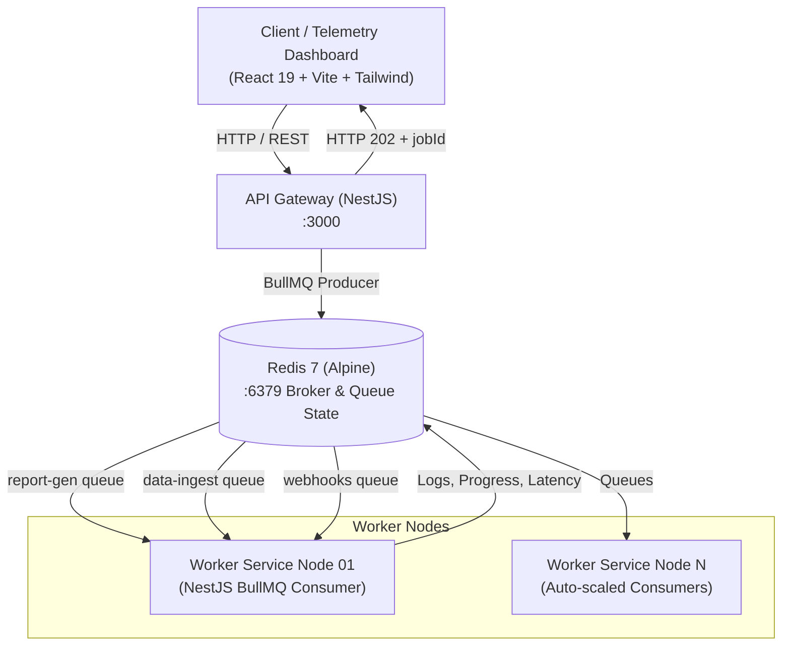

# Distributed Task & Event Pipeline Architecture

High-throughput, distributed microservices platform for asynchronous job dispatch, Redis queue orchestration via BullMQ, and decoupled worker consumers, paired with an infrastructure telemetry dashboard.

---

## 🏗️ Architectural Topology



---

## 📦 System Components

### 1. `backend/api-gateway` (Port 3000)
- **Role:** HTTP Ingestion & Telemetry Broker.
- **Features:**
  - `POST /api/jobs/dispatch`: Validates DTOs with `class-validator`, pushes jobs to target Redis queue, returns HTTP 202 (Accepted) and unique `#job-XXXXXX` ID.
  - `GET /api/jobs`: Filterable (`all`, `active`, `waiting`, `completed`, `failed`), paginated queue listing.
  - `GET /api/jobs/:id`: Detailed job state, live progress (0-100%), worker logs, and execution latency.
  - `GET /api/cluster/metrics`: Telemetry reporting throughput (ops/sec), active jobs, queue depth, and failure rates.
  - Interactive OpenAPI / Swagger documentation at `http://localhost:3000/api/docs`.

### 2. `backend/worker-service` (Headless Consumer Node)
- **Role:** Decoupled asynchronous background execution engine.
- **Queues Handled:**
  - `report-gen`: Monthly & daily financial report compilation (`report.monthly`, `report.daily`).
  - `data-ingest`: High-velocity event stream validation and CSV batch ingestion (`events.batch`, `csv.import`).
  - `webhooks`: External subscriber dispatch with HMAC-SHA256 signatures and exponential backoff retry policies (`webhook.deliver`).
- **Telemetry Emitted:** Step-by-step stdout logs, execution latency (ms), assigned worker identity (`worker-01`), and progress updates.

### 3. `frontend` (Port 5173)
- **Role:** Infrastructure & Job Telemetry Console (Master-Detail View).
- **Aesthetic:** Geist / Linear dark obsidian console (`#09090b` canvas, `#111113` panels, fine `border-zinc-800/80` borders, dual typography Inter + JetBrains Mono).
- **Features:**
  - Top header with live Redis ping healthcheck and quick dispatch trigger.
  - 4-card KPI strip: Throughput (ops/sec), In-flight jobs, Backlog queue depth, and Failure rate.
  - Master-Detail layout: 45% job stream with status pills and mini progress bars; 55% inspector with Terminal Logs, JSON payload viewer, and retry metadata.
  - Interactive Dispatch Job Modal with preconfigured templates.

---

## 🚀 Quickstart & Commands

### Prerequisites
- Node.js 20+ (Node 22/24 recommended)
- Docker & Docker Compose v2+

---

### Option A: Running with Docker Compose (Recommended)

To build and spin up the complete cluster (Redis, API Gateway, Worker Node, and Dashboard):

```bash
# Clone and enter directory
git clone https://github.com/Sebas000000/distributed-task-pipeline.git
cd distributed-task-pipeline

# Build and start all 4 services
docker compose up --build -d

# Check cluster logs in real time
docker compose logs -f
```

#### Access Points:
- 🖥️ **Telemetry Dashboard:** [http://localhost:5173](http://localhost:5173)
- 🔌 **API Gateway:** [http://localhost:3000/api](http://localhost:3000/api)
- 📚 **Swagger OpenAPI Docs:** [http://localhost:3000/api/docs](http://localhost:3000/api/docs)
- 🗄️ **Redis Broker:** `localhost:6379`

---

### Option B: Local Development Mode

#### 1. Start Redis:
```bash
docker run -d --name task-pipeline-redis -p 6379:6379 redis:7-alpine redis-server --appendonly yes
```

#### 2. Start API Gateway:
```bash
cd backend/api-gateway
npm install
npm run start:dev
```

#### 3. Start Worker Service:
```bash
cd backend/worker-service
npm install
npm run start:dev
```

#### 4. Start Frontend Console:
```bash
cd frontend
npm install
npm run dev
```

---

## 🧪 Testing Job Dispatch via cURL

### Dispatch Monthly Financial Report
```bash
curl -X POST http://localhost:3000/api/jobs/dispatch \
  -H "Content-Type: application/json" \
  -d '{
    "queueName": "report-gen",
    "payloadType": "report.monthly",
    "priority": 5,
    "payload": {
      "reportMonth": "2026-10",
      "currency": "USD",
      "recipients": ["cfo@company.com"],
      "includeCharts": true
    }
  }'
```

### Inspect Cluster Telemetry
```bash
curl http://localhost:3000/api/cluster/metrics
```

### Query Job Details
```bash
curl http://localhost:3000/api/jobs/#job-9a8f2c
```